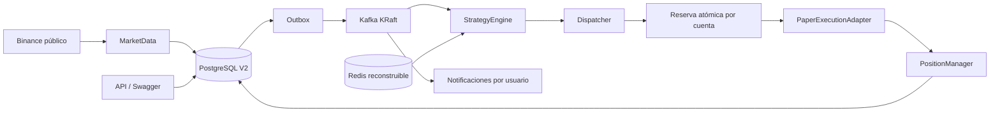

# volBot V2 — BTCUSDT, exclusivamente PAPER

## BTC-V3 experimental y simulador causal

La rama `feature/btc-v3-research-and-fixes` implementa validación de riesgo al fill y capacidad de liquidez basada sólo en la vela anterior, compartida entre cuentas. Conserva las señales `btc-v2` y añade `btc-v3` con tendencia 1h, retroceso/ATR 5m, recuperación 1m y abstención por calibración económica. **Las cuentas siguen pausadas y no se aprobaron estrategias.**

BTC-V3 realizó cero operaciones en las ventanas observadas y en marzo 2025 final: es abstención, no rentabilidad demostrada. Ninguna estrategia operante del holdout superó a USDT. El detalle está en [estrategia](docs/btc-v3-strategy.md), [backtesting](docs/btc-v3-backtesting.md), [correcciones](docs/simulator-fixes.md), [V2 frente a V3](docs/btc-v2-vs-v3.md) y [limitaciones](docs/btc-v3-limitations.md). CSV/JSON completos y los hashes congelados están en `reports/btc-v3/` (local, ignorado por Git).

Para un servidor Node configurado explícitamente, `V3_PARAMETERS_JSON` permite umbrales versionados y `V3_CALIBRATION_FILE`/`V3_CALIBRATION_SHA256` cargan un modelo verificado. El hash del modelo debe corresponder a los parámetros y al horizonte; no hay fallback a una predicción basada en TP. En Docker, estos valores y el archivo deben pasarse mediante un override explícito con montaje de sólo lectura; Compose V2 conserva su configuración existente. La migración aditiva registra versiones nuevas y sólo se aplicó en pruebas aisladas. No se redesplegó API/worker operativo ni se modificó `.env.v2`.

Las pruebas nuevas están en `test/v2/btc-v3-*.ts`. El backtest HTTP admite `btc-v3`, sus parámetros validados y riesgo máximo; no acepta calibración ni aprobación proporcionadas por clientes. Un reporte de cero operaciones puede registrarse pendiente y no concede aprobación. El journal de la prueba final impide repetirla automáticamente: no borrarlo ni reutilizar marzo para ajustar parámetros conservando la etiqueta fuera de muestra.

Backend NestJS para investigar estrategias sobre datos públicos de Binance, operar con saldos virtuales, persistir resultados y comparar backtests. No promete rentabilidad. Ninguna configuración habilita trading real.

## Inicio rápido

Requisitos: Node.js22, npm, Docker Engine/Desktop con Compose y acceso a los hosts públicos de datos Binance. En PowerShell usar `npm.cmd` si la política del sistema bloquea `npm.ps1`.

```powershell
npm.cmd ci --ignore-scripts
Copy-Item .env.v2.example .env.v2
# Completar V2_POSTGRES_PASSWORD, V2_DATABASE_URL, V2_JWT_SECRET y V2_ADMIN_PASSWORD.
# Usar secretos aleatorios únicos; NO agregar API Keys Binance.
docker compose --env-file .env.v2 -f docker-compose.v2.yml up -d --build
docker compose --env-file .env.v2 -f docker-compose.v2.yml run --rm --no-deps api node dist/v2/cli.js seed
```


Swagger: http://localhost:3100/api/docs

OpenAPI: http://localhost:3100/api/docs-json ; copia reproducible en [docs/openapi.json](docs/openapi.json).

La cuenta inicial usa `V2_INITIAL_CAPITAL=500`, máximo5 y30 USDT por operación, y nace **pausada**. Iniciar sesión en `POST /api/auth/login` con los valores locales de administrador y usar Authorize en Swagger. Habilitar entradas requiere primero aprobación administrativa explícita de la versión/configuración/evidencia; sin ella la siguiente solicitud devuelve 409. La auditoría actual no justifica concederla. Consultar [auditoría del simulador](docs/simulator-audit.md) y [diagnóstico de estrategia](docs/strategy-diagnostics.md).

```http
PATCH /api/me/entries
Authorization: Bearer <token>
Content-Type: application/json

{"enabled":true}
```

Consultar `/api/me/balance`, `/api/me/positions`, `/api/me/orders`, `/api/me/fills` y `/api/me/stats`. Para pausar entradas enviar `{"enabled":false}`; las posiciones siguen supervisadas.

## Objetivo y arquitectura

V2 separa señales compartidas, riesgo por cuenta y ejecución simulada. Conserva las fórmulas técnicas existentes y su puntuación como `legacy-v1`; añade `btc-v2` experimental con tendencia1h, confirmación5m y entrada1m.



Tecnologías: NestJS11, TypeScript, TypeORM, PostgreSQL16, Redis7, Kafka3.9.1/KafkaJS, Decimal.js, JWT/bcrypt, Jest/Supertest y Docker. No hay microservicios independientes ni frontend Next.js en esta entrega.

## Estructura

```text
src/v2/
  api/            DTOs, autorización, controladores y Swagger
  backtesting/    motor cronológico, comparación y métricas
  domain/         cuentas, órdenes, posiciones y contratos financieros
  events/         envelopes versionados, Kafka, outbox e inbox
  execution/      adaptador PAPER sin cliente de red
  market/         WebSocket público, backfill, filtros y caché Redis
  notifications/  entrega desacoplada por destinatario
  persistence/    entidades y migraciones aditivas V2
  strategy/       legacy-v1 y btc-v2
  trading/        dispatcher, riesgo, ejecución y supervisión
src/utils/indicators.ts  fórmulas técnicas reutilizadas
src/main.ts       proceso API
src/worker.ts     proceso de trading PAPER
src/v2/cli.ts     migración, seed, descarga y backtest
```

El código V1 permanece en sus carpetas y está fuera del arranque. Sus métodos de envío/cancelación Binance fallan siempre. La documentación previa está en [docs/v1/README.md](docs/v1/README.md).

## Entorno

V2 lee únicamente `.env.v2`, no el `.env` de V1. Ver [.env.v2.example](.env.v2.example).

| Variable | Uso |
|---|---|
| V2_DATABASE_URL | Base dedicada `volbot_v2`; no se admite una base V1 |
| V2_POSTGRES_PASSWORD | Contraseña local PostgreSQL para Compose; usar hex URL-safe |
| V2_JWT_SECRET | Secreto único de32+ caracteres; sin valor de respaldo |
| V2_REFRESH_TOKEN_TTL_DAYS | Duración del refresh token rotativo; 7 días por defecto, máximo 30 |
| V2_COOKIE_SECURE | `true` en HTTPS; `false` sólo para desarrollo local HTTP |
| V2_CORS_ORIGIN | Origen explícito del frontend local, por ejemplo `http://localhost:5173` |
| V2_ADMIN_EMAIL / V2_ADMIN_PASSWORD | Creación inicial de administrador; contraseña de12+ caracteres |
| V2_INITIAL_CAPITAL | Capital virtual inicial;500 por defecto |
| V2_REDIS_URL | Caché, localhost:16379 fuera de Docker |
| V2_KAFKA_BROKERS | localhost:19092 fuera de Docker |
| V2_STRATEGY | `btc-v2` o `legacy-v1` |
| V2_FEE_RATE | Comisión por lado;0,001 |
| V2_SPREAD_BPS / V2_SLIPPAGE_BPS | Spread total y slippage por lado |
| V2_PARTICIPATION_RATE | Fracción de volumen simulada;0,001 |
| V2_TAKE_PROFIT / V2_ATR_MULTIPLIER | Objetivo y distancia ATR experimentales |
| V2_MAX_HOLDING_HOURS / V2_TRAILING | Límite temporal y trailing experimental |
| V2_TELEGRAM_ENABLED / V2_TELEGRAM_BOT_TOKEN | Telegram opcional; apagado por defecto |
| TRADING_MODE | Sólo se acepta PAPER |

Los importes se calculan con decimales y se devuelven principalmente como strings. Nunca introducir claves reales en los archivos V2.

## Docker y procesos

El Compose V2 crea su propio proyecto, red y volúmenes. Puertos externos ligados a loopback:3100(API),15432(PostgreSQL),16379(Redis),19092(Kafka). Son configurables. El servicio `kafka-init` asigna permisos al volumen nuevo antes del broker.

Para levantar sólo la infraestructura, incluido Kafka KRaft sin ZooKeeper:

```powershell
docker compose --env-file .env.v2 -f docker-compose.v2.yml up -d postgres redis kafka
```

Para desarrollo fuera de contenedores:

```powershell
npm.cmd run build
npm.cmd run db:migrate
npm.cmd run seed
npm.cmd run start:dev
# En otra terminal:
npm.cmd run worker:dev
```

La migración es explícita y aditiva. Compose la ejecuta como servicio separado antes de API/worker. No se modifica el esquema V1 ni se usa synchronize.

## Usuarios de prueba

Como administrador, usar `POST /api/admin/users`:

```json
{"email":"a@example.com","name":"Usuario A","password":"<contraseña única de 12+ caracteres>","initialCapital":500,"maxPositions":5,"usdtPerTrade":30}
```

Para UsuarioB: capital200, máximo3 y20 USDT. Iniciar sesión por separado y habilitar sus entradas. Cada uno recibe la misma señal de mercado, pero tiene cuenta, decisiones, posiciones e historial propios.

Sólo el administrador elige el capital inicial al crear una cuenta. No se ofrecen depósitos, retiros ni sincronización de saldo Binance. Cada usuario puede modificar únicamente sus dos límites en `PATCH /api/me/config`.

## Señales y protección

Sólo BTCUSDT, velas cerradas1m/5m/1h. Se precargan100 por intervalo, se deduplican por timestamp y se recuperan huecos. Un cambio de no elegible a elegible genera una señal compartida versionada.

El dispatcher reserva capital y cupo dentro de una transacción PostgreSQL bloqueada por cuenta. Los IDs de señal, decisiones e inbox impiden repetir compras. Órdenes pendientes y resultados desconocidos siguen consumiendo capacidad.

btc-v2 calcula el stop inicial con ATR y estructura, y TP como porcentaje configurable del precio efectivo. Se modelan trailing experimental, invalidación de tendencia y time stop. No hay compras automáticas para promediar pérdidas. Ver [estrategia](docs/trading-strategy.md) y [riesgo](docs/risk-management.md).

## Simulación y P&L

MARKET, LIMIT, protecciones, cancelaciones, parciales por participación de volumen, redondeos y filtros mínimos. El modelo considera spread, slippage y comisión USDT. No reproduce exactamente liquidez, colas, latencias ni fills de Binance.

Ganancia realizada = ingreso de venta después de comisión − costo proporcional de compra, incluida su comisión. Las posiciones abiertas y dust conservan inventario y resultado no realizado. Las pérdidas por stop se incluyen en estadísticas.

Swagger permite consultar balance, ledger, fills, posiciones, órdenes y decisiones. No se mezclan datos V1 con PAPER.

## Backtesting y comparaciones

```powershell
npm.cmd run market:download -- --start 2025-01-01 --end 2025-02-01 --output btcusdt-1m.json
npm.cmd run backtest -- --input btcusdt-1m.json --strategy btc-v2 --capital 500 --max-positions 5 --usdt 30 --output report.json
npm.cmd run backtest -- --input btcusdt-1m.json --compare --output comparison.json
```

El procesamiento es cronológico, con entrada en apertura siguiente y sin usar datos futuros. TP y SL en una misma vela: prevalece SL. Las comparaciones separan entrenamiento/validación/fuera de muestra70/15/15 y no optimizan sobre el último tramo.

Los reportes incluyen hash de datos, configuración, revisión, trades, fills, ledger, equity y métricas. El backtest antiguo BTC/USD invertido está archivado, no validado como referencia de rentabilidad. Ver [backtesting](docs/backtesting.md).

## Contrato HTTP

Prefijo `/api`; autenticación Bearer JWT de15 minutos. El usuario activo y la versión del token se verifican en cada petición. `POST /auth/login` y `POST /auth/refresh` devuelven sólo el access token: el refresh token opaco, rotativo y revocable se entrega exclusivamente en una cookie `HttpOnly`, `SameSite=Lax`. `POST /auth/logout` lo revoca. Los cuerpos desconocidos se rechazan y las respuestas no incluyen secretos.

| Área | Rutas principales |
|---|---|
| Auth | POST /auth/login; POST /auth/refresh; POST /auth/logout; GET /me |
| Configuración | GET/PATCH /me/config; PATCH /me/entries |
| Mercado | GET /market/status; GET /market/candles; GET /strategies; GET /signals |
| Simulación | GET /me/balance, /positions, /orders, /fills, /ledger, /decisions, /stats |
| Acciones PAPER | POST /me/positions/:id/close; POST /me/orders/:id/cancel |
| Backtest | POST /backtests; GET /backtests/:id |
| Admin | GET/POST /admin/users; PATCH /admin/users/:id/status; PATCH /admin/users/:id/notifications |
| Recuperación | GET /admin/dead-letters; POST /admin/dead-letters/:id/replay |
| Salud | GET /health/live; GET /health/ready |

Regenerar el contrato con `npm.cmd run docs:openapi`. No es necesario conectarse a ninguna dependencia para generarlo. La API está preparada para un dashboard posterior; esta entrega no incluye frontend.

## Tests y recuperación

Los resultados efectivamente ejecutados y sus límites están en [docs/validation.md](docs/validation.md). El primer backtest público de btc-v2 fue negativo; no constituye una estrategia validada para obtener ganancias.

```powershell
npm.cmd run lint
npm.cmd run typecheck
npm.cmd test
npm.cmd run build
# Crear una sola vez la base de integración separada:
docker compose --env-file .env.v2 -f docker-compose.v2.yml exec -T postgres createdb -U volbot_v2 volbot_v2_test
npm.cmd run test:integration
```

Las pruebas de integración usan `volbot_v2_test`; nunca la base V1. Si faltan las variables de integración, la suite normal las omite explícitamente. El test de transporte Kafka usa un topic aislado con retención corta.

Ante una caída, reiniciar sólo V2. PostgreSQL conserva cuenta, órdenes, fills, ledger y outbox. Kafka admite reentregas; el inbox confirma junto con el efecto financiero. Un evento agotado queda en DLQ y puede reproducirse como administrador. La supervisión PAPER se retrasa durante un corte de Kafka y recupera velas; no representa una protección de exchange real.

```powershell
docker compose --env-file .env.v2 -f docker-compose.v2.yml logs --tail 100 worker api
docker compose --env-file .env.v2 -f docker-compose.v2.yml restart worker
# Detener conservando volúmenes:
docker compose --env-file .env.v2 -f docker-compose.v2.yml down
```

No usar `down -v` para recuperar un sistema con resultados que se quieran conservar.

## Limitaciones y próximos pasos

- Simulación sobre OHLC cerrado1m; no libro de órdenes ni garantía de equivalencia con Binance.
- Kafka local con una réplica, sin alta disponibilidad.
- Backtests HTTP síncronos; conjuntos grandes deben ejecutarse por CLI.
- Drawdown en vivo se informa sin medición si no hay curva de equity; el backtest sí lo calcula.
- Telegram es opcional. WhatsApp V1 se conserva fuera del arranque y requiere un adaptador V2 posterior; no se inicia Chromium.
- La IA/Ollama V1 no participa en decisiones V2.
- No hay gestión de credenciales Binance ni transición a LIVE.
- Optimizar lecturas de agregados, retención y proyecciones antes de escalar el historial.
- Completar pruebas prolongadas de recuperación y evaluar estrategias fuera de muestra antes de interpretar resultados financieros.

## Documentación técnica

[Arquitectura](docs/architecture.md) · [Estrategias](docs/trading-strategy.md) · [Riesgo](docs/risk-management.md) · [Kafka](docs/kafka-events.md) · [Paper](docs/paper-trading.md) · [Backtesting](docs/backtesting.md) · [Base de datos](docs/database.md) · [Despliegue](docs/deployment.md) · [Migración V1–V2](docs/migration-v1-v2.md).
## Investigación de rentabilidad neta

El protocolo, las 12 candidatas, los costos de estrés y los resultados están en [docs/net-profit-research.md](docs/net-profit-research.md). Ninguna estrategia superó los filtros de robustez; las entradas PAPER y reales siguen bloqueadas. La prueba final reservada permanece sin evaluar.

La [fase 2 de optimización](docs/net-optimization-phase2.md) compara seis modificaciones aisladas de pullback, walk-forward con embargo y costos completos. Sus experimentos y decisiones se conservan por separado en `reports/net-optimization-phase2/`; no habilitan entradas ni consumen la prueba final reservada.

