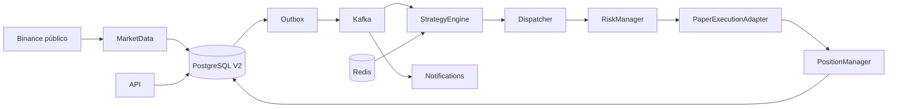

# Arquitectura V2

Monolito modular NestJS con dos procesos: API HTTP y worker. Ambos usan PostgreSQL V2; sólo el worker recibe mercado y consume Kafka. No se importa ningún módulo de ejecución Binance V1 desde sus grafos de arranque.

## Decisiones

1. PostgreSQL es la fuente de verdad. El estado financiero se guarda en tablas `v2_*`, separadas de V1 y en una base cuyo nombre debe empezar por `volbot_v2`.
2. La fila de cuenta se bloquea con `FOR UPDATE` antes de cargar o cambiar posiciones, reservas y ledger. Dos workers no pueden reservar simultáneamente el mismo cupo.
3. Cada transición de cuenta y sus eventos outbox se confirman en una sola transacción. El inbox se confirma con el efecto del consumidor. Una entrega repetida no repite el efecto.
4. Mercado y estrategia son compartidos; cuentas, decisiones, órdenes y posiciones son individuales.
5. El adaptador real no es un provider y siempre arroja un error. Los métodos mutantes heredados también fallan antes de usar su cliente. No hay configuración LIVE.
6. Redis sólo conserva caché de historia reconstruible. La estrategia puede leer PostgreSQL si Redis cae.
7. Una conexión PostgreSQL dedicada mantiene un advisory lock para un único recolector de mercado. Las cuentas conservan su bloqueo transaccional aunque existan varios consumidores.

## Límites operativos

El almacenamiento inicial carga el historial de una cuenta dentro de su transacción; no está optimizado para millones de fills. La retención/compactación y proyecciones incrementales son trabajo posterior. Las rutas de backtest son síncronas y acotadas a 50.000 velas; para conjuntos grandes usar CLI fuera del proceso API.

No existe promesa de entrega exactamente una vez hacia Telegram: una caída después del envío y antes del commit puede repetir el mensaje. Eso no repite una operación financiera.
