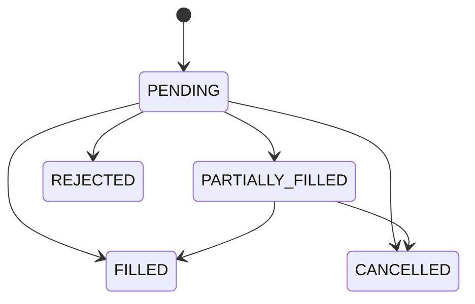

# Ejecución exclusivamente simulada

`PaperExecutionAdapter` no contiene cliente HTTP ni SDK Binance. La única fuente Binance del grafo activo es `PublicMarketClient`, con hosts exclusivos de datos y whitelist GET de `klines`/`exchangeInfo`.

## Estados

Las posiciones pasan por OPENING → OPEN → CLOSING → CLOSED. REJECTED significa entrada sin inventario; DUST conserva inventario no vendible. UNKNOWN es un estado explícito que mantiene reservas.

## Modelo de ejecución

MARKET usa precio de referencia más/menos medio spread y slippage. Los precios BUY se redondean hacia arriba y SELL hacia abajo. Las cantidades se redondean hacia abajo al step. LIMIT no ejecuta a un precio peor que su límite. Las protecciones se guardan con la posición y generan una orden al activarse.

La participación máxima sobre volumen limita fills y admite parciales. Dentro de una cuenta se comparte el presupuesto de liquidez de una vela. Cada cuenta es una simulación independiente: no se modela competencia entre usuarios por el mismo libro.

Comisiones en USDT, tasa configurable. No se modela descuento BNB. Cada fill registra cantidad bruta, quote y comisión. El costo de compra ya incluye la comisión de entrada; al vender se resta del ingreso neto el costo proporcional asignado, sin descontar la entrada nuevamente.

La protección se evalúa con OHLC cerrado de 1m, no tick a tick. En una vela ambigua se prioriza SL; un gap bajista usa la apertura peor. No se modela profundidad, cola de órdenes, latencia exacta ni impacto de mercado.

Pausar `entries` conserva supervisión. Cerrar una posición desde la API solicita una salida para la siguiente vela. Cancelar órdenes es exclusivamente local a PAPER y libera sólo las reservas correspondientes.

El reinicio restaura órdenes, posiciones, fills y balances de PostgreSQL; Redis puede reconstruirse. Las posiciones históricas V1 nunca se cargan en estas cuentas.

Telegram está deshabilitado inicialmente. Para activarlo, configurar las variables V2 y vincular cada chat mediante `PATCH /api/admin/users/:id/notifications`. El administrador debe verificar que el chat pertenece al usuario; no existe destinatario global de respaldo. WhatsApp V1 permanece archivado y no se inicia desde V2.
